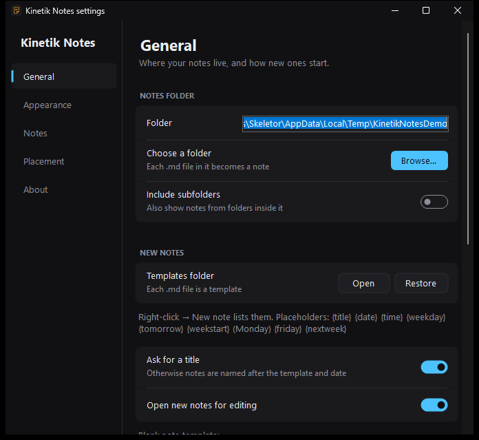

# Kinetik Notes: Markdown sticky notes for the Windows desktop

**Kinetik Notes** is a free, open-source **sticky notes widget for Windows 11 and Windows 10** that shows a folder of Markdown files on your desktop, one note per file. Point it at an Obsidian folder (a to-do list, a project folder) and the notes follow it live: edit a file anywhere and the note updates; tick a task on the note and the file changes.

It's a small portable app with no installer and no account. It's a companion to [Kinetik Stats](https://github.com/WastedDesigner/Kinetik), the taskbar system monitor, and [Kinetik Calendar](https://github.com/WastedDesigner/KinetikCalendar), and shares their look.

> **About this project:** I made this for my own desktop and decided to share it in case anyone else finds it useful. If you run into a bug or have an idea for a feature, please [open an issue](../../issues).

## What's new in 2.0

Part of the Kinetik apps, with [Kinetik Stats](https://github.com/WastedDesigner/Kinetik) (the taskbar monitor, called just Kinetik until its v4.0), [Kinetik Hub](https://github.com/WastedDesigner/KinetikHub) and the other desktop widgets.

- **Settings in Kinetik Stats' layout:** a title on each page, rows that join into cards, and switches, drop-downs and buttons in the app theme instead of Windows' own.
- **App theme:** one theme and accent colour for every Kinetik app's windows and menus: Match Windows, Graphite, OLED black, Midnight, Nord, Mocha, Forest, Light or Paper, with a Sky, Violet, Mint, Amber, Rose or Coral accent or your Windows accent. Pick it in Settings → General, under **App theme** in the right-click menu, in Kinetik Hub or in Kinetik Stats, and every app follows.
- **Widget themes:** new **OLED black** and **Mocha**, and **Match app theme**, which uses the app theme and accent colour.
- **New icon** in the Kinetik apps' "Graphite glass" style.

## Features

- **One note per Markdown file** in a folder you choose (optionally including subfolders), followed live as files change
- **Tick off tasks** (`- [ ] …`) right on the note; the change is written back to the file
- **Task count, progress bar, due dates and tags** on each note
- **Per-note options in front matter**, so Obsidian sees them too: `color: pink`, `title: …`, `pinned: true`, `due: 2026-10-20`, `tags: [web, marking]`
- **Sorting** by file name, title, last changed, due date or most open tasks, with pinned notes first
- **Filtering:** only notes with a tag, hide finished tasks, hide notes whose tasks are all done, hide or collapse individual notes
- **New notes** from the tray or right-click menu, optionally from a templates folder
- **Double-click** a note to open it in Obsidian, your default editor or File Explorer
- **Themes:** pastel and vivid paper, dark themes, or Auto to match Windows; six note colours; custom font, width, columns, rounding and opacity
- **Show / hide all notes with Ctrl+Alt+N**, lock position, snap to screen edges, run at startup
- **Settings backup** next to the exe, offered again on a fresh Windows

## Download and use

1. Download `KinetikNotes.zip` from [Releases](../../releases/latest) and extract it anywhere.
2. Run `KinetikNotes.exe`. It opens Settings so you can choose your notes folder.
3. Right-click a note or the tray icon for the menu.

Settings are kept in `HKCU\Software\KinetikNotes`. Nothing is sent anywhere: the app only reads and writes the Markdown files in the folder you pick.

## Requirements

Windows 10 or 11 (64-bit) with .NET Framework 4.8, which ships with both.

## Building from source

No SDK needed: `build.bat` compiles `KinetikNotes.cs` with the .NET Framework compiler that ships with Windows. `build.bat package` also makes `KinetikNotes.zip` for a release.

`KinetikNotes.exe --demo` runs a separate copy with made-up notes in a temporary folder that reads and saves no settings, which is how the screenshots were made. Add `--theme Navy` (or any theme name) to pick its theme.

## Tests and packaging

`python tests/run-tests.py` runs the regression checks (no window opens). `build.bat package` builds the exe and makes the release zip, checking every file in it against its SHA-256 hash. The shared support code (`SuiteSupport.cs`) is compiled into the exe, so there's no extra DLL.

When you tick a task, Kinetik Notes keeps the note's previous version in a `.kinetik-recovery` folder beside it. If the file changed after the note was shown (in Obsidian, say), the tick is refused: refresh and try again.

## License

[GPL-3.0-or-later](LICENSE). Copyright © 2026 Akila Sella Hennedige.
